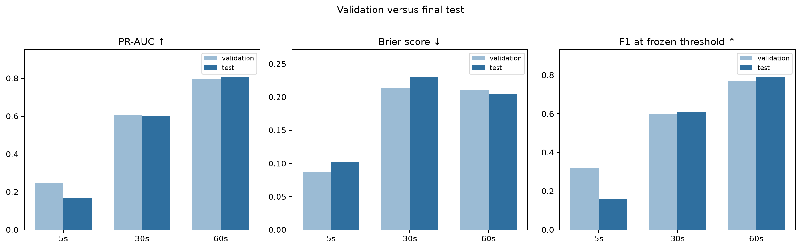
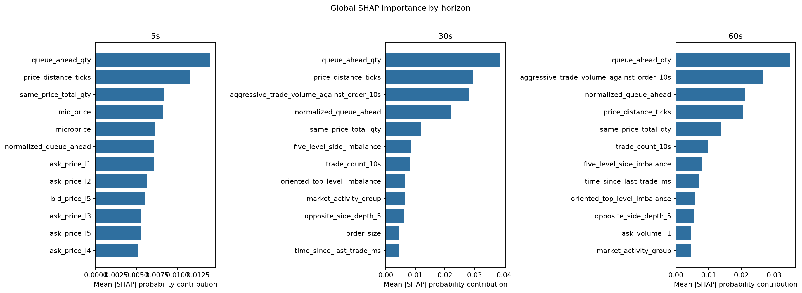

# Limit Order Fill Probability Prediction

> An end-to-end market-microstructure study of whether a resting AAPL limit order will fill within 5, 30, or 60 seconds.

This repository turns order state, queue position, limit-order-book conditions, and recent order flow into calibrated fill-probability estimates. The workflow uses a chronological train/validation/test split, freezes model and threshold choices before opening the test set, and reports both predictive performance and failure modes.

**Project status:** the research workflow is complete; reproducibility hardening is the next milestone.

> [!IMPORTANT]
> The dataset is deterministic synthetic teaching data. Results must not be interpreted as evidence about real AAPL or Nasdaq execution.

## Results at a glance

Held-out test performance:

| Horizon | Selected model | Feature set | Eligible orders | Actual fill rate | Predicted fill rate | ROC-AUC | PR-AUC | Brier | ECE | F1 |
|---:|---|---|---:|---:|---:|---:|---:|---:|---:|---:|
| 5s | Logistic regression | Order + LOB | 1,460 | 11.8% | 6.4% | 0.616 | 0.170 | 0.102 | 0.014 | 0.158 |
| 30s | Random forest | Order + LOB + flow | 1,311 | 44.5% | 64.2% | 0.650 | 0.600 | 0.230 | 0.035 | 0.611 |
| 60s | Random forest | Order + LOB + flow | 1,234 | 64.3% | 96.4% | 0.690 | 0.805 | 0.205 | 0.028 | 0.789 |

The headline result is deliberately mixed:

- Ranking performance improves with the horizon, but the 5-second task remains difficult and generalizes poorly.
- Recent order-flow features help the selected 30- and 60-second models.
- The 50-snapshot history feature block does **not** add robust incremental value; no final model uses it.
- The 60-second operating threshold predicts almost every eligible order as filled. Its F1 is high because fills are common, but the decision policy is not operationally selective.
- Queue position and price distance are among the most influential features.

Full tables, caveats, and artifact links are in [`RESULTS.md`](RESULTS.md).





## Research design

The prediction question is:

> Given information available at observation time \(t_0\), what is the probability that an active resting limit order fills within a fixed horizon?

The design protects the time ordering of the problem:

```text
10,000 orders + 50 pre-submission LOB snapshots per order
                         │
                         ▼
     first 14 days train ─ next 3 validate ─ final 3 test
                         │
                         ▼
       feature sets A–D: order state, LOB, flow, history
                         │
                         ▼
 baseline → logistic regression → decision tree → random forest
                         │
                         ▼
       probability calibration + validation-only threshold
                         │
                         ▼
         frozen policy → one-time held-out test evaluation
                         │
                         ▼
       ablation, slice analysis, SHAP and LIME explanations
```

Each horizon has its own eligibility mask to handle right-censoring. Rows without enough observation time are excluded rather than labelled as non-fills.

## Repository map

| Path | Purpose |
|---|---|
| [`notebooks/`](notebooks/) | Numbered research workflow from data audit through final evaluation |
| [`src/`](src/) | Reusable feature, modelling, evaluation, and explainability helpers |
| [`results/`](results/) | Machine-readable metrics, policy files, diagnostics, and explanations |
| [`reports/`](reports/) | Technical report, presentation, and publication-ready figures |
| [`docs/`](docs/) | Feature definitions and supporting project notes |
| [`data/README.md`](data/README.md) | Local data setup, provenance, and integrity checks |

## Quick start

### 1. Create the environment

```bash
git clone https://github.com/yaya0526/limit-order-fill-prediction.git
cd limit-order-fill-prediction

python -m venv .venv
source .venv/bin/activate
pip install -r requirements.txt
```

On Windows, replace the activation command with:

```powershell
.\.venv\Scripts\Activate.ps1
```

### 2. Add the local data

Create `data/raw/` and place exactly these two files inside it:

```text
data/raw/
├── AI_Order_Execution.xlsx
└── Single_Symbol_LOB_History_50_10000.json.gz
```

The raw files are intentionally not redistributed. See [`data/README.md`](data/README.md) for accepted source filenames, expected dimensions, and validation checks.

### 3. Run the research workflow

```bash
jupyter lab
```

Run the numbered notebooks in ascending order. Existing committed outputs let reviewers inspect the completed study without access to the restricted raw files; re-running the full pipeline requires both source files above.

## Evaluation principles

- **Chronological holdout:** train on 14 days, validate on 3, test on the final 3.
- **No test-set tuning:** model, calibration method, and classification threshold are frozen first.
- **Imbalance-aware metrics:** PR-AUC, Brier score, expected calibration error, and horizon-specific fill rates complement ROC-AUC.
- **Ablation before complexity:** feature groups are added incrementally to identify whether LOB, order flow, and history features earn their complexity.
- **Interpretability with limits:** SHAP and LIME describe model behaviour; they do not establish causal market mechanisms.

## What this project does—and does not—show

This project demonstrates a disciplined fixed-horizon probability-modelling workflow on synthetic data. It does not claim a profitable trading strategy, live execution readiness, causal effects, or transferability to real exchange data. Important next steps include environment pinning, automated tests, command-line reproduction, notebook output sanitization, and evaluation on real or independently simulated data.

## Reports and research artifacts

- [`RESULTS.md`](RESULTS.md): concise findings and artifact index
- [`reports/`](reports/): technical report, presentation, and figures
- [`results/final_test_metrics.csv`](results/final_test_metrics.csv): held-out metrics
- [`results/final_test_summary.json`](results/final_test_summary.json): final policies and evaluation summary
- [`results/validation_test_comparison.csv`](results/validation_test_comparison.csv): generalization deltas
- [`docs/feature_reference.md`](docs/feature_reference.md): feature definitions

## Citation and license

Citation metadata are provided in [`CITATION.cff`](CITATION.cff).

Code and repository documentation are released under the [MIT License](LICENSE). The license does not grant redistribution rights for the separately supplied course data.
