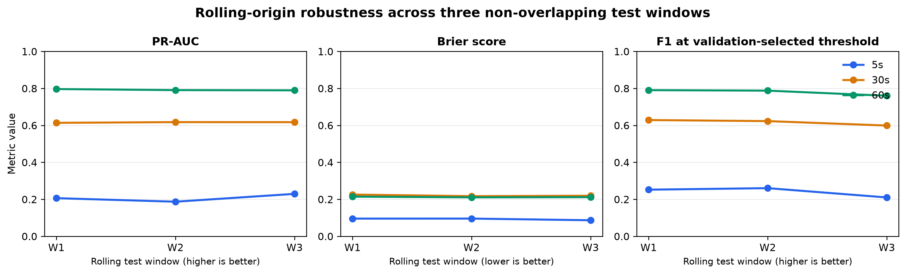
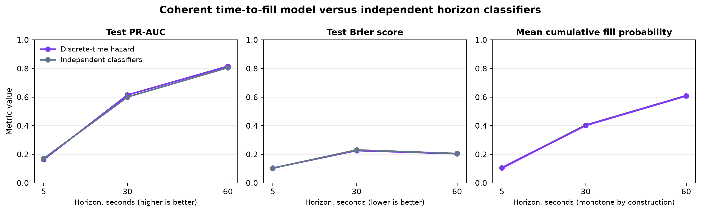
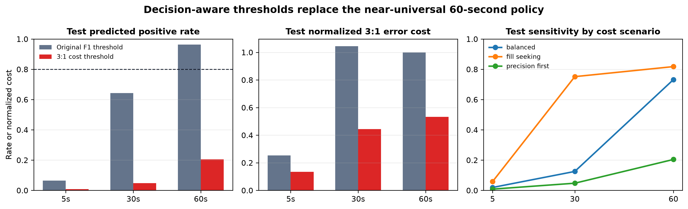
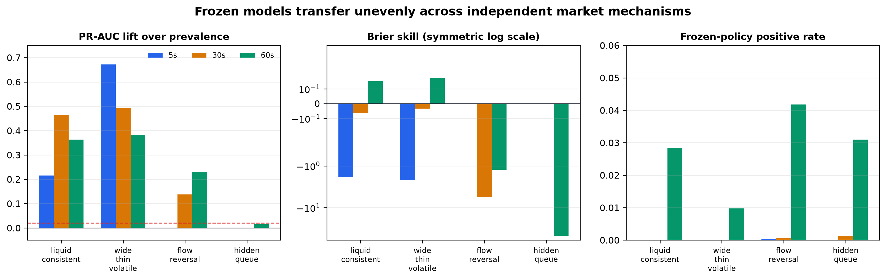

# Limit Order Fill Probability Prediction

[](https://github.com/yaya0526/limit-order-fill-prediction/actions/workflows/ci.yml)
[](https://github.com/yaya0526/limit-order-fill-prediction/releases/latest)
[](https://www.python.org/downloads/release/python-3110/)
[](LICENSE)

> An end-to-end market-microstructure study of whether a resting AAPL limit order will fill within 5, 30, or 60 seconds.

This repository turns order state, queue position, limit-order-book conditions, and recent order flow into calibrated fill-probability estimates. The workflow uses a chronological train/validation/test split, freezes model and threshold choices before opening the test set, and reports both predictive performance and failure modes.

**Project status:** the core workflow and research milestones R1–R4 are complete, covering rolling robustness, coherent time to fill, decision-aware thresholds, and independent simulation stress tests. The R5 licensed-data intake and audit package is ready, but real-data validation has not started because no authorized event stream is present. Automated raw-data-free validation and unit tests protect the published artifacts.

> [!IMPORTANT]
> The dataset is deterministic synthetic teaching data. Results must not be interpreted as evidence about real AAPL or Nasdaq execution.

## 60-second reviewer demo

Inspect the committed held-out results without the restricted raw data or third-party packages:

```bash
python scripts/demo_results.py
```

The command validates the published metric table, prints the frozen 5-, 30-, and 60-second policies, and surfaces the main interpretation caveats. Add `--json` for machine-readable output. This is the fastest path for a reviewer; the full notebook workflow remains documented below.

## Results at a glance

Held-out test performance:

| Horizon | Selected model | Feature set | Eligible orders | Actual fill rate | Predicted fill rate | ROC-AUC | PR-AUC | Brier | ECE | F1 |
|---:|---|---|---:|---:|---:|---:|---:|---:|---:|---:|
| 5s | Logistic regression | Order + LOB | 1,460 | 11.8% | 6.4% | 0.616 | 0.170 | 0.102 | 0.014 | 0.158 |
| 30s | Random forest | Order + LOB + flow | 1,311 | 44.5% | 64.2% | 0.650 | 0.600 | 0.230 | 0.035 | 0.611 |
| 60s | Random forest | Order + LOB + flow | 1,234 | 64.3% | 96.4% | 0.690 | 0.805 | 0.205 | 0.028 | 0.789 |

The headline result is deliberately mixed:

- Ranking performance improves with the horizon, but the 5-second task remains difficult and generalizes poorly.
- Recent order-flow features help the selected 30- and 60-second models.
- The 50-snapshot history feature block does **not** add robust incremental value; no final model uses it.
- The 60-second operating threshold predicts almost every eligible order as filled. Its F1 is high because fills are common, but the decision policy is not operationally selective.
- Queue position and price distance are among the most influential features.

Full tables, caveats, and artifact links are in [`RESULTS.md`](RESULTS.md).


### Rolling-origin robustness

The selected model specifications were also refitted and evaluated across three non-overlapping chronological test windows, while the original final test period remained untouched.

| Horizon | PR-AUC, mean ± SD | Brier, mean ± SD | F1, mean ± SD | Pooled predicted fill rate |
|---:|---:|---:|---:|---:|
| 5s | 0.208 ± 0.021 | 0.093 ± 0.005 | 0.241 ± 0.027 | 43.3% |
| 30s | 0.616 ± 0.002 | 0.221 ± 0.004 | 0.617 ± 0.016 | 73.4% |
| 60s | 0.792 ± 0.004 | 0.212 ± 0.002 | 0.779 ± 0.017 | 94.1% |

The 30- and 60-second ranking results are stable across windows. The 60-second policy remains weakly selective in every period, while the 5-second threshold is visibly unstable. See the [`rolling-origin study`](docs/rolling_origin_robustness.md) for the design, day-block uncertainty intervals, and limitations.



### Coherent time-to-fill probabilities

A discrete-time hazard model now produces a single cumulative fill distribution across the three horizons. It handles cancellation/expiry as right-censoring and eliminates contradictory cross-horizon probabilities.

| Horizon | Hazard PR-AUC | Independent PR-AUC | Hazard Brier | Independent Brier |
|---:|---:|---:|---:|---:|
| 5s | 0.162 | 0.170 | 0.103 | 0.102 |
| 30s | 0.614 | 0.600 | 0.226 | 0.230 |
| 60s | 0.815 | 0.805 | 0.203 | 0.205 |

The model records zero monotonicity violations across 3,000 validation/test orders. It improves the 30- and 60-second results slightly but gives up some 5-second performance. See the [`time-to-fill study`](docs/time_to_fill_model.md) for risk-set construction and limitations.



### Decision-aware operating points

Validation thresholds now minimize a stated error cost instead of F1 alone. Under the primary scenario, a false positive carries three times the cost of a false negative.

| Horizon | Original F1 positive rate | 3:1 cost positive rate | Original cost/order | 3:1 cost/order |
|---:|---:|---:|---:|---:|
| 5s | 6.4% | 0.8% | 0.253 | 0.134 |
| 30s | 64.2% | 4.7% | 1.044 | 0.443 |
| 60s | 96.4% | 20.4% | 0.999 | 0.533 |

The new 60-second policy is selective, but high precision comes with lower recall. Balanced and fill-seeking scenarios show how the action rate changes when costs change. These are normalized sensitivity weights, not trading P&L. See the [`decision-threshold study`](docs/decision_thresholds.md).



### Independent simulation stress test

Frozen models and R3 thresholds were evaluated on four code-defined scenarios whose generator does not read the source workbook. The scenarios independently change spread, depth, volatility, order flow, and queue mechanics.

| Scenario | Transfer horizons | Mean PR-AUC lift | Mean Brier skill | Regime result |
|---|---:|---:|---:|---|
| Liquid consistent | 3/3 | 0.347 | -0.589 | Successful ranking transfer |
| Wide/thin/volatile | 3/3 | 0.516 | -0.674 | Successful ranking transfer |
| Flow reversal | 2/3 | 0.184 | -3.407 | Successful but poorly calibrated |
| Hidden queue | 0/3 | 0.015 | -47.216 | Failure regime |

Ranking survives several shifts, but calibration transfers only for the two 60-second visible-queue scenarios. Frozen decision thresholds are mostly inactive after the shift, and hidden queue priority breaks transfer completely. See the [`independent simulation study`](docs/independent_simulation.md).



### Licensed real-data readiness

R5 now has a machine-readable provenance manifest, normalized level-3 event contract, streaming intake validator, integrity and chronology checks, leakage guards, and a venue-reconstruction audit protocol. This is infrastructure, not empirical evidence: the milestone remains incomplete until authorized data pass every gate and an independent reviewer signs off.

See the [`real-data validation protocol`](docs/real_data_validation_protocol.md) and machine-readable [`readiness status`](results/real_data_readiness_status.json).

## Research design

The prediction question is:

> Given information available at observation time $t_0$, what is the probability that an active resting limit order fills within a fixed horizon?

The design protects the time ordering of the problem:

```text
10,000 orders + 50 pre-submission LOB snapshots per order
                         │
                         ▼
     first 14 days train ─ next 3 validate ─ final 3 test
                         │
                         ▼
       feature sets A–D: order state, LOB, flow, history
                         │
                         ▼
 baseline → logistic regression → decision tree → random forest
                         │
                         ▼
       probability calibration + validation-only threshold
                         │
                         ▼
         frozen policy → one-time held-out test evaluation
                         │
                         ▼
       ablation, slice analysis, SHAP and LIME explanations
                         │
                         ▼
      three-window rolling-origin robustness audit
                         │
                         ▼
     censoring-aware discrete-time fill-hazard model
                         │
                         ▼
       validation-only cost-aware operating thresholds
```

Each horizon has its own eligibility mask to handle right-censoring. Rows without enough observation time are excluded rather than labelled as non-fills.

## Repository map

| Path | Purpose |
|---|---|
| [`notebooks/`](notebooks/) | Numbered research workflow from data audit through final evaluation |
| [`src/`](src/) | Reusable feature, modelling, evaluation, and explainability helpers |
| [`results/`](results/) | Machine-readable metrics, policy files, diagnostics, and explanations |
| [`reports/`](reports/) | Technical report, presentation, and publication-ready figures |
| [`docs/`](docs/) | Feature definitions and supporting project notes |
| [`data/README.md`](data/README.md) | Local data setup, provenance, and integrity checks |
| [`tests/`](tests/) | Raw-data-free unit and repository-contract tests |
| [`scripts/check_repository.py`](scripts/check_repository.py) | One-command validation of published artifacts and links |
| [`scripts/demo_results.py`](scripts/demo_results.py) | Standard-library demo of the committed held-out results |
| [`scripts/run_rolling_origin.py`](scripts/run_rolling_origin.py) | Reproducible rolling-origin robustness experiment |
| [`scripts/run_time_to_fill.py`](scripts/run_time_to_fill.py) | Reproducible censoring-aware time-to-fill experiment |
| [`scripts/run_decision_thresholds.py`](scripts/run_decision_thresholds.py) | Reproducible cost-aware threshold sensitivity analysis |
| [`scripts/run_independent_simulation.py`](scripts/run_independent_simulation.py) | Frozen-policy transfer test on independent scenarios |
| [`scripts/check_real_data_readiness.py`](scripts/check_real_data_readiness.py) | R5 provenance, integrity, schema, chronology, and leakage gate |
| [`docs/limitations_and_roadmap.md`](docs/limitations_and_roadmap.md) | Evidence boundaries and prioritized follow-up research |
| [`docs/rolling_origin_robustness.md`](docs/rolling_origin_robustness.md) | R1 design, results, uncertainty, and limitations |
| [`docs/time_to_fill_model.md`](docs/time_to_fill_model.md) | R2 hazard construction, coherence tests, and results |
| [`docs/decision_thresholds.md`](docs/decision_thresholds.md) | R3 cost matrix, operating points, and sensitivity |
| [`docs/independent_simulation.md`](docs/independent_simulation.md) | R4 generator, transfer criteria, successes, and failures |
| [`docs/real_data_validation_protocol.md`](docs/real_data_validation_protocol.md) | R5 licensed-data, venue reconstruction, and independent-audit gates |
| [`.github/workflows/ci.yml`](.github/workflows/ci.yml) | Automated Python 3.11 checks for pushes and pull requests |

## Full reproduction

### 1. Create the environment

```bash
git clone https://github.com/yaya0526/limit-order-fill-prediction.git
cd limit-order-fill-prediction

python -m venv .venv
source .venv/bin/activate
pip install -r requirements.txt
```

On Windows, replace the activation command with:

```powershell
.\.venv\Scripts\Activate.ps1
```

### 2. Add the local data

Create `data/raw/` and place exactly these two files inside it:

```text
data/raw/
├── AI_Order_Execution.xlsx
└── Single_Symbol_LOB_History_50_10000.json.gz
```

The raw files are intentionally not redistributed. See [`data/README.md`](data/README.md) for accepted source filenames, expected dimensions, and validation checks.

### 3. Run the research workflow

```bash
jupyter lab
```

Run the numbered notebooks in ascending order. Existing committed outputs let reviewers inspect the completed study without access to the restricted raw files; re-running the full pipeline requires both source files above.

The R1 robustness extension uses only the Excel workbook because the frozen policies use feature sets B and C:

```bash
python scripts/run_rolling_origin.py --excel data/raw/AI_Order_Execution.xlsx
```

Run the coherent time-to-fill extension with the same workbook:

```bash
python scripts/run_time_to_fill.py --excel data/raw/AI_Order_Execution.xlsx
```

Run the decision-aware threshold extension:

```bash
python scripts/run_decision_thresholds.py --excel data/raw/AI_Order_Execution.xlsx
```

Run the independent simulation stress test. The generator itself is public and source-data independent; the workbook is used only to reconstruct the frozen source models:

```bash
python scripts/run_independent_simulation.py --excel data/raw/AI_Order_Execution.xlsx
```

When an authorized normalized event package is available, run the R5 intake gate before any reconstruction or modelling:

```bash
python scripts/check_real_data_readiness.py \
  --manifest /authorized/path/manifest.json \
  --events /authorized/path/events.csv
```

### 4. Run the raw-data-free checks

```bash
python scripts/check_repository.py
python -m pytest -q
```

These commands validate the reusable code, notebook structure, result schemas, local links, and privacy checks without requiring the Excel or JSON inputs. See the [`reproducibility guide`](docs/reproducibility.md) for Conda setup and the single-command `make ci` option.

## Evaluation principles

- **Chronological holdout:** train on 14 days, validate on 3, test on the final 3.
- **No test-set tuning:** model, calibration method, and classification threshold are frozen first.
- **Rolling-origin audit:** three additional chronological test windows measure temporal dispersion without touching the original final test period.
- **Dependence-aware uncertainty:** the robustness extension resamples whole trading days rather than individual rows.
- **Censoring-aware event time:** the hazard extension excludes within-interval censoring and guarantees non-decreasing cumulative probabilities.
- **Explicit decision objective:** validation-only cost minimization replaces F1 as the sole threshold rule and reports sensitivity to cost ratios.
- **Independent generator stress test:** frozen models and thresholds are scored under four declared market mechanisms without scenario-specific retuning.
- **Imbalance-aware metrics:** PR-AUC, Brier score, expected calibration error, and horizon-specific fill rates complement ROC-AUC.
- **Ablation before complexity:** feature groups are added incrementally to identify whether LOB, order flow, and history features earn their complexity.
- **Interpretability with limits:** SHAP and LIME describe model behaviour; they do not establish causal market mechanisms.

## What this project does—and does not—show

This project demonstrates disciplined probability and decision-policy workflows on synthetic data. R4 provides limited transfer evidence between synthetic generators, not evidence about real AAPL. R5 tooling defines what authorized real-data validation must prove, but has not produced real-data results. The project does not claim a profitable trading strategy, live execution readiness, causal effects, or transferability to real exchange data. The detailed [`limitations and research roadmap`](docs/limitations_and_roadmap.md) records the completed R1–R4 milestones and the externally blocked R5 evidence gate.

## Reports and research artifacts

- [`RESULTS.md`](RESULTS.md): concise findings and artifact index
- [`reports/`](reports/): technical report, presentation, and figures
- [`results/final_test_metrics.csv`](results/final_test_metrics.csv): held-out metrics
- [`results/final_test_summary.json`](results/final_test_summary.json): final policies and evaluation summary
- [`results/validation_test_comparison.csv`](results/validation_test_comparison.csv): generalization deltas
- [`results/rolling_origin_summary.csv`](results/rolling_origin_summary.csv): rolling-window means, dispersion, pooled metrics, and block intervals
- [`docs/rolling_origin_robustness.md`](docs/rolling_origin_robustness.md): robustness methodology and interpretation
- [`results/time_to_fill_metrics.csv`](results/time_to_fill_metrics.csv): coherent hazard-model discrimination and calibration
- [`docs/time_to_fill_model.md`](docs/time_to_fill_model.md): censoring, probability coherence, and R2 interpretation
- [`results/decision_threshold_comparison.csv`](results/decision_threshold_comparison.csv): cost-aware versus F1 operating points
- [`docs/decision_thresholds.md`](docs/decision_thresholds.md): decision objective, selectivity, and sensitivity
- [`results/independent_simulation_metrics.csv`](results/independent_simulation_metrics.csv): R4 scenario/horizon transfer metrics
- [`docs/independent_simulation.md`](docs/independent_simulation.md): independent generator design and R4 interpretation
- [`schemas/real_data_manifest.schema.json`](schemas/real_data_manifest.schema.json): licensed-data provenance contract
- [`schemas/normalized_l3_event.schema.json`](schemas/normalized_l3_event.schema.json): normalized event-row contract
- [`docs/real_data_validation_protocol.md`](docs/real_data_validation_protocol.md): R5 intake, reconstruction, evaluation, and audit protocol
- [`docs/feature_reference.md`](docs/feature_reference.md): feature definitions
- [`docs/reproducibility.md`](docs/reproducibility.md): environment and verification instructions
- [`docs/limitations_and_roadmap.md`](docs/limitations_and_roadmap.md): evidence boundary and research plan
- [`docs/releases/v0.1.0.md`](docs/releases/v0.1.0.md): first public release notes
- [`CHANGELOG.md`](CHANGELOG.md): repository change history

## Citation and license

Citation metadata are provided in [`CITATION.cff`](CITATION.cff).

Code and repository documentation are released under the [MIT License](LICENSE). The license does not grant redistribution rights for the separately supplied course data.
